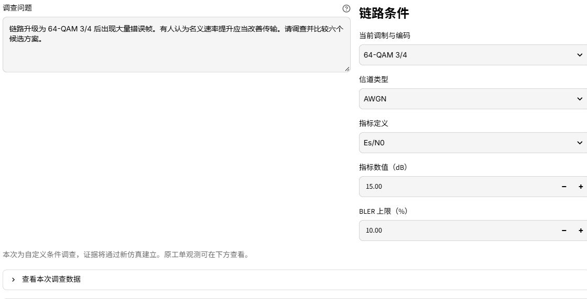

# 无线链路调制与编码选择调查 Agent

面向无线链路测试与优化的 Python Agent，将自然语言工单转化为参数检查、通信仿真、候选配置比较和可追溯的调制编码建议。项目使用 DeepSeek Flash、PydanticAI 2.68.0 和 Streamlit，支持网页操作与命令行运行。

用户可以描述“升级调制方式后错误帧增加”等问题，也可以直接修改链路条件。Agent 根据当前证据选择工具，比较不同解释，结合误块率、有效吞吐和置信区间形成结论。完整调查记录保存模型消息、工具参数、计算结果、证据编号及专业 Skill 的版本哈希。

## 主要功能

- 在网页中编辑当前调制编码、信道类型、信噪比指标定义、指标数值和 BLER 上限，按新条件开展调查。
- 比较 QPSK、16-QAM、64-QAM 与 1/2、3/4 码率组成的六种 MCS，支持 AWGN 和瑞利块衰落信道。
- 实际执行卷积编码、穿孔、QAM 调制、软解调与 Viterbi 译码，统计误块率和计入帧开销的有效吞吐。
- 展示候选假设、支持证据、反证、不确定性及后续行动，通过 Wilson 置信区间检查样本是否充分。
- 对照直接 LLM、Agent + Tools、Agent + Tools + Skill 三组效果，支持离线重新评分及调查记录下载。



## 调查示例

C02 工单给出 AWGN、Es/N0=8 dB、BLER 上限 10% 的链路。当前 64-QAM 3/4 在一次 512 帧仿真中全部失败。Agent 比较六个候选后推荐 QPSK 3/4，该次试验出现 4 个错误帧，BLER 约 0.78%，95% 区间上界约 1.99%，有效吞吐约 1.141 Mbps。完整记录可以追溯每一步工具调用与结论依据。[查看本次调查记录](results/runs/C02_C_r1.json)

## 阅读入口

- 了解系统结构与工具之间的关系。[系统架构图](docs/architecture.png) · [调查流程图](docs/workflow.png)
- 查看专业调查步骤和停止条件。[专业 Skill](skills/wireless-mcs-investigation/SKILL.md)
- 核查评分规则、实验汇总和原始记录。[评测协议](tests/evaluation_protocol.md) · [结果汇总](results/summary.csv) · [72 次运行记录](results/runs)

## 系统组成

| 模块 | 文件 | 作用 |
| --- | --- | --- |
| 交互入口 | `app.py`、`src/main.py` | Streamlit 与命令行 |
| Agent | `src/agent.py` | 三组配置、结构化输出、预算及完整调用记录 |
| 模型接入 | `src/model.py` | 本地配置与 DeepSeek Provider |
| 调查工具 | `src/investigation_tools.py` | 工单读取、单位及上界计算、仿真、同条件方案比较 |
| 通信模型 | `src/simulation.py` | QAM、编码、信道、软判决译码与统计 |
| 专业 Skill | `skills/wireless-mcs-investigation/SKILL.md` | 指标核对、反证、样本充分性与调查步骤 |
| 公开案例 | `data/cases.json` | 八类工单、原始观测与业务要求 |
| 测试与评测 | `tests/` | 单元验证、参考生成、正式对照及离线重评分 |
| 调查与评测记录 | `results/` | 候选性能、评测汇总及完整工具调用记录 |

四个实际工具为 `get_link_case`、`calculate_link_limits`、`simulate_mcs`、`compare_mcs_results`。工具返回带编号的结构化证据。C 组实际读取 Skill 内容，调用记录保存其 SHA256。架构及流程图见 `docs/architecture.png` 和 `docs/workflow.png`。

## 环境安装

已验证环境为 Windows、Python 3.13.2。下列命令在项目根目录的 PowerShell 中执行。

```powershell
python -m venv .venv
.\.venv\Scripts\python.exe -m pip install -r requirements-lock.txt
.\.venv\Scripts\python.exe -m pip check
```

`requirements.txt` 固定主要直接依赖，`requirements-lock.txt` 保存本次环境的完整版本快照。主程序依赖 PydanticAI、NumPy、SciPy、Pandas、Matplotlib 和 Streamlit。

首次使用时复制配置模板，并在本地填写密钥。

```powershell
Copy-Item .env.example .env
notepad .env
```

| 配置项 | 设置 | 说明 |
| --- | --- | --- |
| `DEEPSEEK_API_KEY` | 本地填写 | DeepSeek API 凭据 |
| `DEEPSEEK_MODEL` | `deepseek-flash` | 调查入口统一校验此模型 |
| `DEEPSEEK_THINKING` | `false` | 与保存的正式实验一致 |
| `WIRELESS_AGENT_WORK_DIR` | 可选进程环境变量 | 自定义开发证据目录 |

进程环境变量优先于 `.env`。在线调查和重新执行对照实验会产生实际 API 调用费用。单元测试及已保存结果的重新评分可离线运行。

## 运行完整调查

```powershell
.\.venv\Scripts\python.exe -X utf8 -m src.main --case C02 --group C
.\.venv\Scripts\python.exe -m streamlit run app.py
```

浏览器访问 `http://localhost:8501`，选择工单和配置，编辑调查问题，点击“开始调查”。界面展示配置建议、性能表、假设、支持证据、反证及后续行动，也支持下载本次完整记录。“对照评测”页读取随项目提供的正式结果。

右侧“链路条件”可直接修改当前调制编码、信道类型、指标定义、指标数值和 BLER 上限。BLER 输入采用百分数，Es/N0、信息比特 Eb/N0 和带宽内 SNR 均以 dB 输入。仿真参数由这些控件设置，问题文本用于描述调查目标。换算后的 Es/N0 支持 -30 至 60 dB。

参数变更后，点击“开始调查”生成对应结果。自定义记录带有 `_custom` 标识并保存修改前后的参数。物理链路条件变化时，通过新仿真建立证据，原始案例仍可在页面展开查看。仅调整 BLER 业务上限时沿用原工单的链路观测。输入再次变化后，界面提示重新调查。

工单范围为 C01 至 C08。A 组直接询问 LLM，B 组开放四个工具，C 组额外加载专业 Skill。三组采用相同公开案例、模型和结构化输出格式。CLI 的 `--seed` 可指定仿真种子，默认值为 `20261113`。

可单独检查 API、实际工具执行和结构化返回。

```powershell
.\.venv\Scripts\python.exe -X utf8 -m src.check_deepseek
```

所有新运行记录默认写入项目同级的 `<项目目录名>_开发记录/evidence/`。命令行调查位于 `investigations/`，界面调查位于 `ui_runs/`，连接检查位于 `connection_checks/`，均使用时间戳命名。

## 通信条件和测试案例

六种 MCS 由 QPSK、16-QAM、64-QAM 与 1/2、3/4 码率组合而成。卷积码使用约束长度 3、八进制生成多项式 (7,5)，终止补零，3/4 码率串行穿孔序列为 `[1,1,1,0,0,1]`。接收机执行 max-log 软解调与完整帧 Viterbi 译码。

模型使用单位平均符号能量、AWGN 或逐帧独立瑞利块衰落、理想同步及接收端已知信道。每帧包含 192 个净荷比特、32 个帧头比特和 16 个前导符号，符号率 1 Msps，带宽 1.2 MHz，单次传输。有效吞吐计入编码、终止、补齐与前导开销，并采用成功净荷比特数除以总发送时间。BLER 使用双侧 95% Wilson 区间。

| 工单 | 主要问题 |
| --- | --- |
| C01 | 高信噪比下选择可行的高吞吐配置 |
| C02 | 调制升级后错误帧增加 |
| C03 | 极弱信号下的无可行方案判断 |
| C04 | 块衰落与边界候选的样本充分性 |
| C05 | 容量上界论据中的错误线索 |
| C06 | Eb/N0 的参考配置及口径换算 |
| C07 | 信道及指标定义缺失 |
| C08 | 零错误小样本与置信区间 |

## 离线验证

```powershell
.\.venv\Scripts\python.exe -X utf8 -m unittest discover -s tests -v
```

当前共 19 项测试。原有 14 项通信及工具检查覆盖已知编码向量、Gray 星座、六配置无噪恢复、Viterbi 与独立穷举似然一致性、QPSK 理论误码率、零错误区间、重复性、输入边界、单位换算、混合条件拒绝、并发帧预算和穿孔码状态周期检查。新增 5 项检查覆盖界面参数传递、历史观测适用条件、Eb/N0 边界和恢复原始条件。

## 复现评测

正式评测为八案例、三组、三次重复，共 72 次在线调查。原实验配置见 `results/experiment_config.json`，评分协议见 `tests/evaluation_protocol.md`，每次完整 Trace 位于 `results/runs/`。独立参考采用每候选 8192 帧，按可靠性和最低吞吐区间判断可行性，接受与最佳可行吞吐相差 5% 以内的候选。

重新评分已有记录并生成汇总，不产生模型请求。

```powershell
.\.venv\Scripts\python.exe -X utf8 -m tests.evaluate --summarize-only --output results --reference results/reference.json
```

重新生成独立参考并执行在线实验。默认在外部开发证据目录新建时间戳实验目录，同时保存运行前源码快照。

```powershell
.\.venv\Scripts\python.exe -X utf8 -m tests.build_reference
.\.venv\Scripts\python.exe -X utf8 -m tests.evaluate --repeats 3 --concurrency 3
```

可使用 `--reference` 与 `--output` 指定路径。新的在线实验会受到模型服务状态影响，实际调查顺序和结论可能变化。已保存的 72 次记录可以精确复现本次评分。

| 组别 | 任务成功 | 成功率 | 平均耗时 | 平均输入 Token |
| --- | --- | --- | --- | --- |
| A 直接 LLM | 3/24 | 12.5% | 8.91 s | 2443 |
| B Agent + Tools | 22/24 | 91.67% | 13.43 s | 18095 |
| C Agent + Tools + Skill | 23/24 | 95.83% | 12.59 s | 22170 |

三组均完成全部结构化输出。A 组多数案例因缺少实际性能证据而保留配置结论。C 组相对 B 组多完成的一次任务来自 C04 的追加试验。耗时含网络等待和工具执行，正式运行并发数为 3。引用有效率仅检验证据编号的存在性，语义及算术通过案例复核检查。

## 已知限制和保留的失败

- C04_C_r1 识别了区间跨阈值，却在追加样本前结束，最终选择可靠但吞吐较低的配置，按既定目标计为失败。
- 一次界面调查把两种配置的名义信息比特能量差写为 10.8 dB，正确值约 6.532 dB。原始输出见 `results/semantic_review_example.json`，仿真计算采用正确的物理条件。
- 仿真假设包含理想同步、已知信道、独立帧及单次传输。真实设备应用需要信道估计、相关衰落、重传机制及现场测量校准。
- 本次结果来自八个自建案例、三次重复。更广泛的 Skill 效果需要扩展案例和重复实验。

## 接口与理论资料

- [DeepSeek API 文档](https://api-docs.deepseek.com/)
- [PydanticAI DeepSeek 接入](https://pydantic.dev/docs/ai/models/deepseek/)
- [MathWorks SNR 换算](https://www.mathworks.com/help/comm/ref/convertsnr.html)
- [NIST 二项比例置信区间](https://itl.nist.gov/div898/handbook/prc/section2/prc241.htm)
